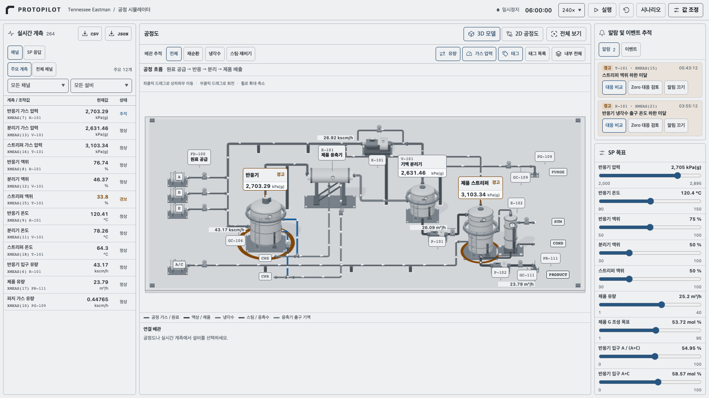
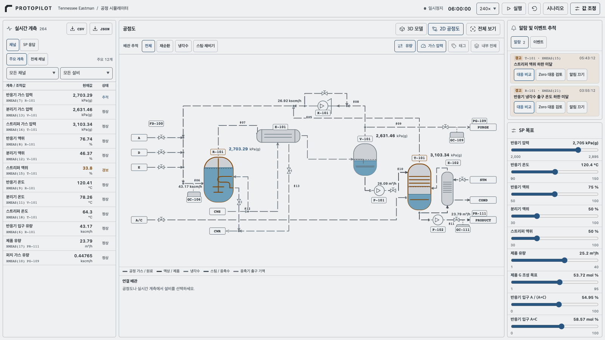
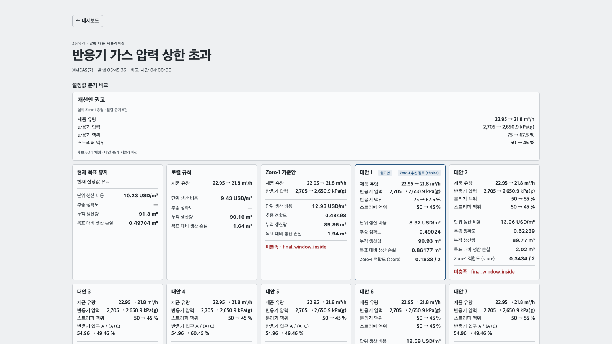
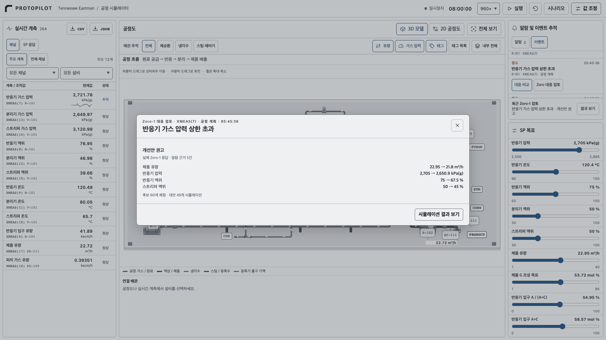
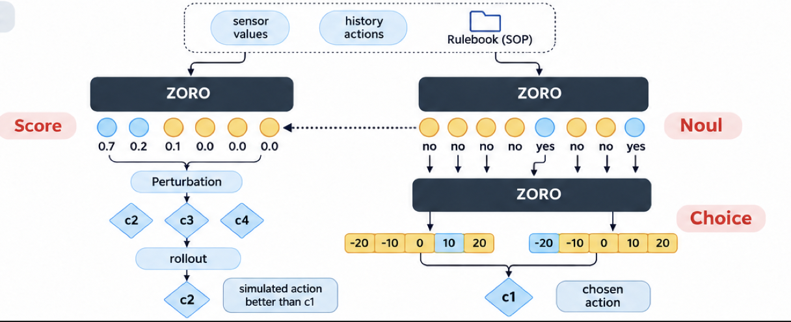
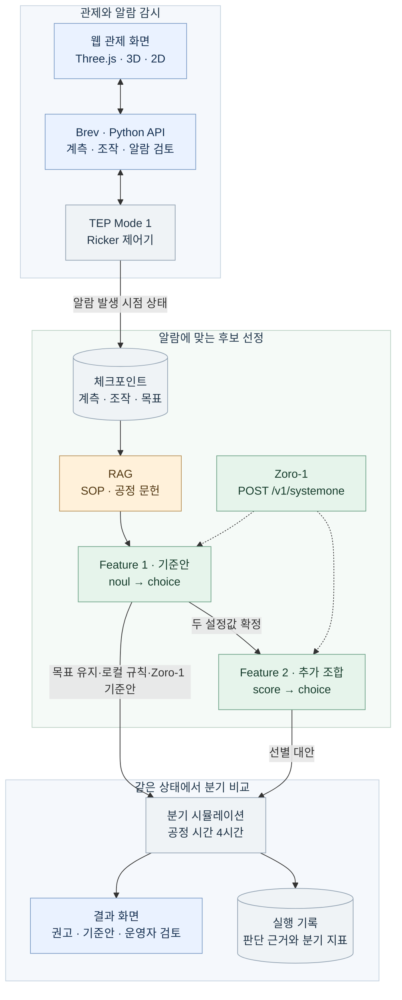
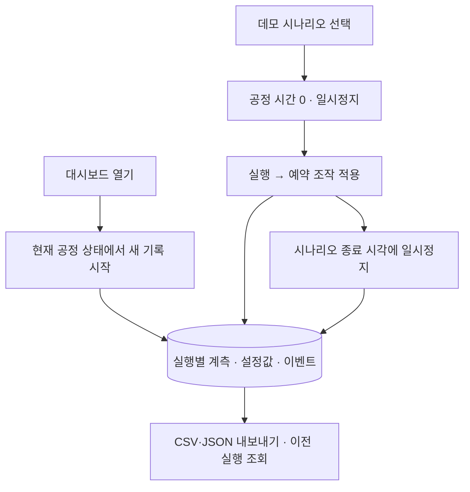
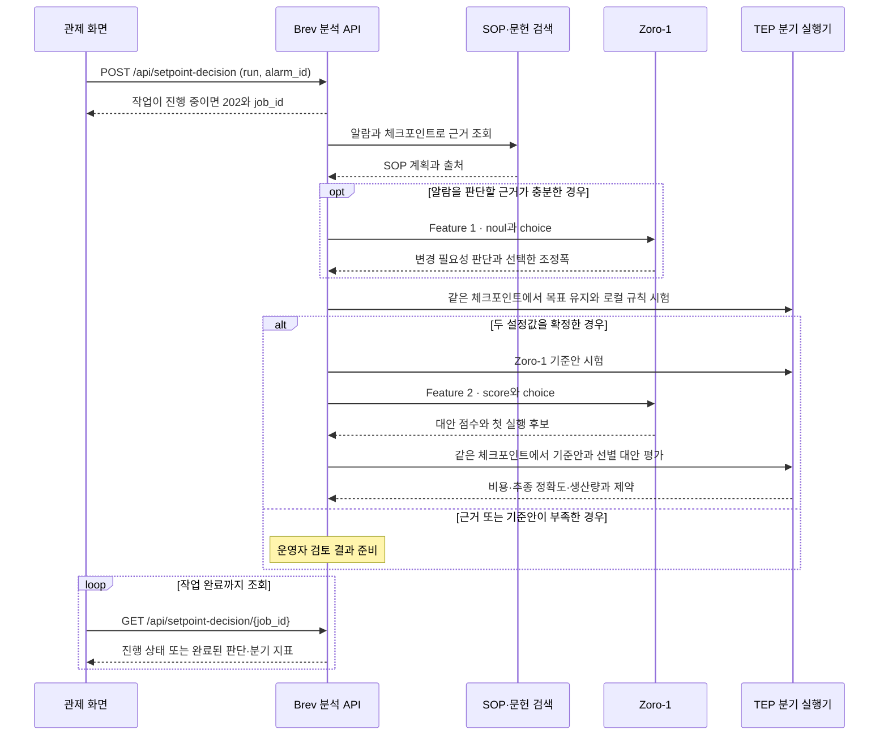

# ProtoPilot

**화학 공정의 복합 알람 대응 시뮬레이터**

ProtoPilot은 Tennessee Eastman Process(TEP)에서 알람 발생 시점의 공정 상태를 재현합니다. 표준운전절차(SOP)와 계측·조작 이력을 바탕으로 Zoro-1이 제안한 대응안을 시험하고, 공정 제약 충족 여부와 비용·생산량을 비교합니다.

**[Brev 라이브 데모](https://protopilot-rx8cin03n.gobrev.dev/)** · [해커톤 발표 자료](https://docs.google.com/presentation/d/1OP7zI-4293JVnL-ZUxfro8mzeUhKAqT7yBn7WfbLIVM/edit?slide=id.p1#slide=id.p1) · [데모 영상](#데모-영상) · [제출 에이전트 로그](docs/agent-log.md) · [기술 문서](#기술과-관련-문서)

<h2 align="center">팀 소개</h2>

<p align="center"><strong>팀 랩틸리언</strong> · Trillion Agent Hackathon 2026 Track 1</p>

<table align="center">
  <tr>
    <td colspan="5" align="center">
      <a href="https://github.com/dkim1112"><br><strong>김동은</strong></a><br>
      <sub>팀장 &amp; PM</sub>
    </td>
  </tr>
  <tr>
    <td align="center" valign="top" width="20%">
      <a href="https://github.com/kanade012"><br><strong>장영하</strong></a><br>
      <sub>라이브 데모<br>개발</sub>
    </td>
    <td align="center" valign="top" width="20%">
      <a href="https://github.com/hongjiyeon56"><br><strong>홍지연</strong></a><br>
      <sub>RAG &amp;<br>Zoro Agent 개발</sub>
    </td>
    <td align="center" valign="top" width="20%">
      <a href="https://github.com/Jangha-Lee"><br><strong>이장하</strong></a><br>
      <sub>SOP &amp;<br>구조 설계</sub>
    </td>
    <td align="center" valign="top" width="20%">
      <a href="https://github.com/dylancho"><br><strong>조형원</strong></a><br>
      <sub>Zoro Agent<br>개발</sub>
    </td>
    <td align="center" valign="top" width="20%">
      <a href="https://github.com/tongtongblueberry"><br><strong>신정민</strong></a><br>
      <sub>시나리오 &amp;<br>모델 성능 개선</sub>
    </td>
  </tr>
</table>

## 어떤 문제를 해결하나요?

공정 이상이 발생하면 운영자는 계측과 알람을 확인하고 조치의 우선순위를 판단해야 합니다. 알람이 짧은 시간에 집중되거나 현장 보고에서 조치 결정까지 시간이 걸리면 대응이 어려워집니다.

- **1994년 영국 밀퍼드헤이븐 텍사코 정유공장 폭발·화재.** 영국 산업안전보건청(HSE) 조사에 따르면, 남아 있던 알람 로그 하나에서만 폭발 직전 **10.7분 동안** 운영자 **2명**이 확인하고 대응해야 할 알람 **275건**이 집계됐습니다. 평균 **2.3초에 한 건**입니다. [HSE 사고 조사보고서 제102항](https://www.jesip.org.uk/wp-content/uploads/2022/03/Texaco-Refinery-Explosion.pdf#page=33)
- **2013년 삼성전자 화성사업장 불산 누출.** 경기지방경찰청의 중간 수사 결과를 보도한 연합뉴스에 따르면, 현장에서 밸브 교체가 필요하다고 보고한 뒤 작업이 승인되기까지 **약 4시간 30분**이 걸렸습니다. 이후 다른 공정에서 가스 감지 알람이 울려 자체 소방대가 출동했습니다. [연합뉴스 사고 경위 재구성](https://www.yna.co.kr/amp/view/AKR20130226113000061)

<p align="center">
  <a href="docs/media/milford-haven-refinery-fire-1994.jpg"></a><br>
  <sub>1994년 밀퍼드헤이븐 정유공장 화재 현장 · 사진 Western Mail and Echo Ltd · 발표 자료 2쪽</sub>
</p>

밀퍼드헤이븐 사례는 알람이 한꺼번에 몰릴 때 중요한 신호를 가려내는 부담을, 화성 사례는 이상을 보고한 뒤 조치를 결정하기까지 걸리는 시간을 보여줍니다. ProtoPilot은 TEP에서 연결된 반응기와 분리기를 재현하고, 온도·압력 등 **기본 계측값 41개**와 조작 이력으로 알람 시점의 공정 상태를 파악합니다. 알람에 맞는 표준운전절차(SOP)를 찾고 **같은 시점의 상태를 복제**해 현재 목표 유지, 로컬 규칙, Zoro-1의 변경안을 시험합니다. 각 대응이 공정 상태와 생산에 미치는 영향을 비교할 수 있습니다.

대응안 평가는 운전 범위와 생산 조건의 충족 여부를 확인하고, 비용·추종 정확도·누적 생산량을 비교하는 방식으로 진행합니다. [시나리오 4 검증 결과](#시나리오-4-검증-결과)

## 무엇을 할 수 있나요?

| 기능 | 이용 방법 |
| --- | --- |
| 실시간 공정 관제 | 3D·2D 공정도에서 설비·배관을 선택하고 온도·압력·액위·유량을 확인합니다. |
| 시나리오 재생 | 데모 시나리오 5개를 불러오거나 외란, 센서 오프셋, 밸브 개도를 조정해 모의 운전을 시험합니다. |
| 알람 대응 검토 | 알람이 울린 시점에 적용할 SOP·문헌 근거를 검색하고 Zoro-1이 제안한 설정값 변경을 확인합니다. |
| 대응안 비교 | 현재 목표 유지, 로컬 규칙, Zoro-1 기준안과 선별 대안을 같은 시점에서 시험하고 분기 지표를 비교합니다. |
| 기록과 내보내기 | 현재 실행의 CSV·JSON을 저장하고, 이전 기록의 계측과 이벤트를 다시 열거나 시나리오를 재생합니다. |

## 이렇게 시작하세요

1. [Brev 라이브 데모](https://protopilot-rx8cin03n.gobrev.dev/)에 접속한 후 **시나리오 → 데모 시나리오**에서 **시나리오 4**를 선택합니다.
2. **불러와 재실행 준비 → 실행**을 누릅니다. 기본 배속에서 약 2분 뒤, 공정 시간 480분에 자동으로 일시정지합니다.
3. **알람 및 이벤트 추적 → 이벤트**에서 **05:45:36(345.6분)**의 반응기 고압 경고를 찾아 해당 항목의 **Zoro 대응 검토**를 누릅니다.
4. Zoro 분석이 끝나면 **시뮬레이션 결과 보기**에서 권고 변경값, 검색 근거, 대안별 지표를 확인합니다. 분석 시간은 시나리오 재생과 별도로 소요됩니다.

공개 데모는 실행 기록을 공유합니다. 다른 접속자가 대시보드를 열면 이벤트 목록이 바뀔 수 있습니다. **05:45:36** 경고가 보이지 않으면 시나리오 4를 다시 불러와 실행하세요.

<table align="center">
  <tr>
    <th align="center" width="50%">3D 관제 화면</th>
    <th align="center" width="50%">2D 공정도</th>
  </tr>
  <tr>
    <td align="center" valign="top">
      <a href="docs/screenshots/00-brev-dashboard.png"></a><br>
      <sub>설비 상태, 실시간 계측값, 알람 및 설정값</sub>
    </td>
    <td align="center" valign="top">
      <a href="docs/screenshots/01-brev-schematic.png"></a><br>
      <sub>배관 연결, 유량, 압력 및 액위</sub>
    </td>
  </tr>
</table>

공개 데모는 한국 IP에서 로그인 없이 이용할 수 있습니다. [데모 시나리오 목록](#데모-시나리오)

## 데모 영상

[해커톤 데모 영상 보기 · 2분 30초](docs/media/protopilot-demo.mp4)

라이브 데모에서 시나리오 4의 재생, 알람 대응 검토 및 분기 비교를 확인할 수 있습니다. [Brev 라이브 데모](https://protopilot-rx8cin03n.gobrev.dev/)

## 시나리오 4 검증 결과

Brev 배포본(`3888bda`)에서 **공정 시간 345.6분**에 발생한 반응기 고압 알람을 분석했습니다. 아래 화면을 기록한 실행에서 Zoro-1은 검색 근거 5건을 바탕으로 **생산량 목표 −5%**와 **반응기 압력 목표 −2%**를 기준안으로 선택했습니다. 추가 변경 조합 60개를 채점한 뒤 선별된 49개를 시뮬레이션했습니다.

권고안은 기준안의 두 변경을 유지하며 **반응기 액위 목표 75 → 67.5%**, **스트리퍼 액위 목표 50 → 45%** 조정을 포함합니다.

| 같은 알람 시점에서 4시간 비교 | 현재 목표 유지 | 로컬 규칙 | Zoro-1 기준안 | 권고안 |
| --- | ---: | ---: | ---: | ---: |
| 단위 생산 비용 | 10.23 USD/m³ | 9.43 USD/m³ | 12.93 USD/m³ | **8.92 USD/m³** |
| 설정값 추종 정확도 | — | — | 0.4850 | 0.4902 |
| 누적 생산량 | **91.30 m³** | 90.16 m³ | 89.86 m³ | 90.93 m³ |
| 종료 구간 운전 범위 | — | — | 미충족 | **충족** |

표에 제시한 네 분기 중 권고안의 단위 생산 비용이 가장 낮았고, 현재 목표 유지의 누적 생산량이 가장 많았습니다. 추종 정확도와 종료 구간 판정은 Zoro-1 기준안과 평가 대안에 제공됩니다.

<p align="center">
  <a href="docs/screenshots/03-brev-branch-results.png"></a><br>
  <sub>Brev 시나리오 4의 현재 목표 유지, 로컬 규칙, Zoro-1 기준안과 권고안 비교</sub>
</p>

<details>
<summary>Zoro 대응 검토 화면</summary>

<p align="center">
  <a href="docs/screenshots/02-brev-zoro-review.png"></a>
</p>

</details>

## 서비스 아키텍처

<p align="center">
  <a href="docs/media/alarm-response-architecture.png"></a>
</p>

ProtoPilot은 같은 알람 시점의 공정 상태에서 각 대응안을 공정 시간 4시간 동안 모의 실행하고, 운전 제약 충족 여부와 비용·추종 정확도·생산량을 비교합니다.

<details>
<summary>상세 아키텍처</summary>

### 전체 구조



서버는 실행 ID와 알람 ID로 체크포인트를 찾습니다. RAG는 알람 태그로 관련 문헌과 SOP를 검색합니다. Zoro-1에는 관측값과 조작 이력, 현재 목표와 검색 근거를 전달하고, 주입한 외란 번호는 시뮬레이터가 분기를 재현할 때 사용합니다. 비교 결과와 판단 근거는 대시보드와 상세 결과 화면에서 확인합니다.

### 시나리오 재생과 실행 기록



데모 시나리오를 불러오면 예약된 조작과 종료 시간을 JSON에서 읽어 새 실행을 준비합니다. 기록에는 조작 명령과 알람 발생·복구 이력도 남습니다. [재생 형식과 데모 알람 기준](docs/scenarios/DEMO_SCENARIOS.md)

### 알람에서 분기 결과까지



### Zoro-1의 세 가지 판단

| 기능 | Zoro-1에 묻는 질문 | 답을 사용하는 방법 |
| --- | --- | --- |
| Feature 1 · `noul` | 이 설정값을 지금 바꿔야 하나? | ‘예’ 확률 **0.5 이상**이고 허용 범위 안에서 바꿀 수 있는 항목 중 상위 두 개를 고릅니다. |
| Feature 1 · `choice` | 어느 방향으로 얼마나 바꿀까? | 생산량 목표에는 **±5%·±10%**, 그 외 조정 가능한 목표에는 **±2%·±4%**를 적용해 허용 범위 안의 후보를 만들고, 모델이 고른 두 변경을 기준안으로 삼습니다. |
| Feature 2 · `score` | 이 두 값을 함께 바꿀 근거가 얼마나 충분한가? | 기준안의 두 변경을 고정하고, 나머지 설정값 둘의 **±10% 조합**을 **0~2점**으로 채점합니다. 점수 합으로 나눈 가중치를 내림차순으로 더해 **누적 90%**에 이르는 최소 조합을 고릅니다. |
| Feature 2 · `choice` | 선별한 조합 중 무엇을 먼저 시험할까? | 두 개 이상 선별되면 모델이 고른 조합을 맨 앞에서 시뮬레이션합니다. |

Feature 1에서 근거가 부족하거나 두 변경을 확정할 수 없으면 **운영자 검토**로 표시합니다. Feature 2는 선별한 조합을 같은 상태에서 실행합니다. 점수 합이 0이면 기준안 평가만 진행합니다. 공정 제약·복귀·품질·생산량 기준을 충족한 분기들의 단위 생산 비용과 추종 정확도를 비교하고, 두 지표가 동률이면 목표 대비 생산 손실이 작은 쪽을 고릅니다. 적격 개선안이 없으면 적격 기준안을 유지하고, 적격 결과가 없으면 운영자 검토로 보냅니다. [Feature 1 구현](features/feature1-setpoint-gate/README.md) · [Feature 2 구현](features/feature2-sop-ranking/README.md) · [Zoro-1 응답 형식](zoro/README.md)

</details>

## 데모 시나리오

| 시나리오 | 확인할 상황 | 공정 시간 |
| --- | --- | ---: |
| 1. 경제 운전 중 밸브 스틱션 | 원료 조성이 변한 뒤 압력 목표를 높이고, 냉각수 밸브 스틱션이 추가될 때의 온도 알람을 관찰합니다. | 480분 |
| 2. 고온 오경보 | 반응기 온도 표시값이 2분간 상승하며 발생하는 알람과 해제를 확인합니다. | 300분 |
| 3. 냉각 조건 회복 | 냉각 외란과 감산 조작 후 온도 알람이 멈췄다가 다시 발생하는 구간을 관찰합니다. | 720분 |
| 4. 원료 조성·두 설비의 냉각 조건 변동 | 원료 조성, 반응기·분리기 냉각 조건을 동시에 바꾸고 복합 알람에 대한 대응안을 비교합니다. | 480분 |
| 5. 교대 뒤 생산 목표 불일치 | 이전 교대의 증산 목표가 남은 상황을 재현하고 냉각수 온도와 액위 알람을 확인합니다. | 360분 |

값 조정 패널에서 밸브 개도, 설정값, 외란, 센서 오프셋을 바꿔 별도로 시험할 수 있습니다. 진행 중인 실행은 CSV·JSON으로 내려받을 수 있습니다. [예약 조작과 시나리오별 알람 기준](docs/scenarios/DEMO_SCENARIOS.md)

## 데이터와 결과 해석

- 공개 데모에는 TEP의 모의 계측값을 사용합니다. 시뮬레이터 상태는 접속자에게 공유되며, 상세 결과 화면(`/#simulation-result`)은 해당 알람을 분석한 브라우저 탭에서 확인할 수 있습니다.
- `noul`은 설정값 변경 필요성에 대한 모델 응답이고, `score`는 시험할 추가 조합을 선별하는 근거 점수입니다. 비용·추종 정확도·생산량은 각 TEP 분기의 실행 데이터로 계산합니다.
- 동일한 알람 시점과 비교 시간을 기준으로 대안을 평가합니다. 운전 범위·품질·생산 기준의 충족 여부와 비용·생산량 차이를 함께 확인할 수 있습니다.

## 기술과 관련 문서

관제 화면은 **Three.js·esbuild**, 시뮬레이터와 API는 **Python·TEP Studio**를 사용합니다. SOP 검색에는 **BGE-M3·BM25·Qwen3 리랭커**, 설정값 판단에는 **Zoro-1**을 사용하며, 공개 데모는 **NVIDIA Brev**에서 실행합니다.

| 자료 | 내용 |
| --- | --- |
| [해커톤 발표 자료](https://docs.google.com/presentation/d/1OP7zI-4293JVnL-ZUxfro8mzeUhKAqT7yBn7WfbLIVM/edit?slide=id.p1#slide=id.p1) | 문제 배경과 초기 시연 구상. 열람에는 Drive 접근 권한이 필요합니다. |
| [제출 에이전트 로그](docs/agent-log.md) | 해커톤 제출 원문과 사례 3건 |
| [시나리오 명세](docs/scenarios/DEMO_SCENARIOS.md) | 배포 데모 시나리오 5개의 예약 조작과 알람 기준 |
| [Feature 1](features/feature1-setpoint-gate/README.md) · [Feature 2](features/feature2-sop-ranking/README.md) · [Zoro-1 클라이언트](zoro/README.md) | 모델 판단 기준, 분기 평가와 API 응답 형식 |

### 로컬 실행

Python 3.12 또는 3.13, Node.js, npm, Git과 Python C 확장을 빌드할 컴파일러가 필요합니다. macOS에서는 Xcode Command Line Tools의 clang으로 빌드할 수 있습니다.

```sh
python3.13 -m venv .venv
.venv/bin/python -m pip install -r requirements.txt
npm ci
npm start
```

[로컬 관제 화면](http://127.0.0.1:8765/)을 엽니다. 초기화하면 Mode 1의 초기 상태에서 일시정지된 새 실행을 만듭니다. 실제 모델 판단을 사용하려면 Zoro-1 서빙과 알람 RAG 환경을 연결합니다. [Zoro-1 클라이언트](zoro/README.md) · [알람 RAG 설정](features/feature1-setpoint-gate/README.md)

### Brev 서버 구성

| 경로 | 역할 |
| --- | --- |
| [`src/`](src) | Three.js 관제 화면, 2D 공정도, 계측·분기 결과 뷰 |
| [`server/`](server) | Python HTTP API, TEP 상태와 알람, 시나리오 재생·기록 |
| [`features/feature1-setpoint-gate/`](features/feature1-setpoint-gate) | 알람 문헌·SOP 검색, 두 설정값 변경 판단 |
| [`features/feature2-sop-ranking/`](features/feature2-sop-ranking) | 조합 선별, 체크포인트 복제, 분기 비교와 권고 |
| [`zoro/`](zoro) | Zoro-1 요청·응답 타입과 클라이언트 |
| [`scripts/`](scripts), `vendor/trida-stack/` | Brev 실행 스크립트와 Zoro-1 서빙 서브모듈 |

새 Brev 체크아웃에는 로컬 실행과 같은 앱 의존성과 `uv`를 설치합니다. **Zoro 대응 검토**에 필요한 검색기 의존성과 SOP·문헌 인덱스도 미리 준비합니다. [배포용 RAG 인덱스 구축](features/feature1-setpoint-gate/README.md#배포용-rag-인덱스)

같은 인스턴스에서 모델을 서빙할 때는 `.runtime/zoro.env`에 `ZORO_BASE_URL=http://127.0.0.1:30001`을 설정합니다. 필요한 환경에서는 `ZORO_MODEL`, `ZORO_API_KEY`도 지정합니다. 저장소 루트에서 아래 명령으로 모델과 관제 서버를 시작합니다.

```sh
git submodule update --init vendor/trida-stack
scripts/install-zoro.sh
scripts/start-zoro.sh
npm run build
scripts/start-protopilot.sh
```

관제 서버 기본 포트는 `8765`입니다.

### API와 개발 도구

| 진입점 | 용도 |
| --- | --- |
| `GET /api/live` | 실시간 계측, 현재 실행, 알람 및 이벤트 |
| `POST /api/setpoint-decision` | `run`과 `alarm_id`를 받아 알람 시점의 비교 작업 시작 |
| `GET /api/setpoint-decision/{job_id}` | 작업 상태, Zoro-1 판단 및 `feature2.recommended` 조회 |
| `POST /api/alarm-response` | 화면의 **대응 비교**에서 사용하는 SOP 기준안과 감산 조합 비교 |

**Zoro 대응 검토**는 알람 체크포인트를 복제해 각 조치를 시험하고 분석 결과를 반환합니다. 판단과 분기 지표는 데이터 디렉터리의 `agent-trace.jsonl`에 기록됩니다.

`.venv/bin/python -m server.experiments`로 [독립 실험 도구](http://127.0.0.1:8050/experiments/)를 실행할 수 있습니다. 같은 환경에서 `.venv/bin/tep`, `.venv/bin/tep-mcp`(stdio), Gymnasium과 최적화 어댑터를 사용할 수 있습니다.

```sh
.venv/bin/python -m pip install -e ".[dev]"
.venv/bin/python -m pytest
npm run build
```

<details>
<summary>공정도와 로컬 기록 기술 참고</summary>

### Fig. 1 스트림 대조

| 스트림 | 시작 → 도착 | 연결 및 계측 |
| --- | --- | --- |
| 1 | A 원료 → 혼합 헤더 | XMV(3), XMEAS(1) |
| 2 | D 원료 → 혼합 헤더 | XMV(1), XMEAS(2) |
| 3 | E 원료 → 혼합 헤더 | XMV(2), XMEAS(3) |
| 4 | A/C 원료 → 스트리퍼 하부 | XMV(4), XMEAS(4) |
| 5 | 스트리퍼 상부 → 압축기 토출측 헤더 | #8 유량계 뒤에서 합류 |
| 6 | 혼합 헤더 → 반응기 | XMEAS(6), 반응기 입구 분석기 GC-106 |
| 7 | 반응기 상부 → 응축기 → 기액 분리기 | 응축기 출구를 기액 혼합으로 표시 |
| 8 | 기액 분리기 상부 → 압축기 → 혼합 헤더 | 토출 XMEAS(5), 토출→흡입 바이패스 XMV(5) |
| 9 | 기액 분리기 상부 분기 → 퍼지 출구 | XMV(6), XMEAS(10), 퍼지 분석기 GC-109 |
| 10 | 분리기 하부 → 이송 펌프 P-101 → 스트리퍼 측면 | XMV(7), XMEAS(14) |
| 11 | 스트리퍼 하부 → 제품 펌프 P-102 → 제품 출구 | XMV(8), XMEAS(17), 제품 분석기 GC-111 |
| 12 | CWS → 반응기 코일 → CWR | 회수 밸브 XMV(10), 유량 XMEASADD(6) |
| 13 | CWS → 응축기 냉각수측 튜브 → CWR | 회수 밸브 XMV(11), 유량 XMEASADD(8) |
| STM / COND | 스팀 공급 → 재비기 유틸리티측 → 응축수 회수 | XMV(9), 스팀 유량 XMEAS(19) |
| 재비기 공정측 | 스트리퍼 하부 분기 → 재비기 → 스트리퍼 하부 증기 환류 | 스팀과 공정 유체는 별도 유로 |

배관 번호 뒤의 접미사는 같은 스트림의 배관 구간이나 유틸리티 분기를 식별합니다. 별도 유량 태그가 없는 구간은 방향을 표시합니다. 설비의 치수와 내부 형상은 NIST 배치 예시, PlantSim, 현장 사진을 참고한 관측용 도식입니다.

### 공정 화면

- **배관 추적**에서 재순환, 냉각수, 스팀·재비기를 선택하면 해당 회로가 강조되고 공정도 아래에 전체 연결 순서가 표시됩니다.
- **가스 압력**은 XMEAS(7), (13), (16)의 kPa 게이지압을 3D 모델과 2D 공정도의 설비 옆에 표시합니다. 계장용 압축공기 공급압은 TEP 모델의 계측 범위 밖입니다.
- **내부 전체**에서 반응기, 응축기, 분리기, 스트리퍼, 재비기의 내부를 동시에 볼 수 있습니다. 액면은 모델 값을 따라 움직이고, 파란 점선은 액위 목표입니다. 밸브 스템은 커널의 밸브 위치 상태를 따라 움직입니다.
- **3D 모델**의 전체 보기는 2D 공정도의 설비 배치, 밸브와 배관 경로를 따릅니다. A·D·E는 혼합 헤더에 합류하고 A/C는 별도 배관으로 스트리퍼에 공급됩니다.
- **2D 공정도**에서도 주요 유량·가스 압력, 액면·액위 목표가 표시됩니다. 밸브 기호를 선택해 개도를 조정할 수 있습니다.
- **연결 배관** 패널은 3D·2D 공정도나 실시간 계측에서 선택한 설비의 배관 번호와 흐름 방향을 표시합니다.
- 기본 계측 41개, 확장 계측 32개, 내부 진단 179개와 조작 명령 12개를 포함합니다. 조성 분석은 모델의 갱신 주기와 지연을 유지합니다. XMEASCOMP는 원시 단위인 몰분율로 표시하고 저장합니다.
- **실시간 계측** 표에서 각 채널의 현재값을 확인합니다. 선택한 행에는 수신한 최근 최대 60개 값의 추세가 표시됩니다.

### 조정과 확인

- **SP 목표**에서 9개 제어 루프의 목표값을 보고 각각 슬라이더로 변경할 수 있습니다. 슬라이더를 놓으면 목표값이 적용되고, **SP 응답**에 해당 루프의 목표와 계측값의 추세, 편차, 관련 밸브의 실제 위치와 명령값이 표시됩니다.

- **값 조정**에서 폐루프 목표, 조작 명령 XMV, 모델 외란 IDV, 센서 오프셋, 알람 기준을 바꿀 수 있습니다. 일시정지 중 수정한 XMV와 IDV의 물리 응답은 실행을 재개하면 반영됩니다. 압력 목표 변경은 논문 Table 7 예시인 2705 → 2645 kPa(g)로 재현할 수 있습니다.
- 센서 오프셋 시험 시 실제 계산값은 JSON 샘플의 `native_values`에 기록됩니다. 계측 경고는 값이 정상 범위로 돌아오면 해제되고 모델 보호 정지는 상단 상태 표시에서 확인할 수 있습니다.

### 로컬 기록

페이지를 열거나 새로고침하면 고유한 새 폴더를 만들어 현재 공정 상태부터 기록합니다. 이전 폴더의 기록은 보존됩니다. 공정은 같은 로컬 서버에 연결된 브라우저 탭 사이에서 공유됩니다.

기록마다 `data/<run-id>/`에 아래 파일을 저장합니다. 샘플은 기본적으로 약 0.6초마다 기록하며, 센서 오프셋과 알람 기준 수정 시에도 해당 시점의 스냅샷을 남깁니다.

| 파일 | 내용 |
| --- | --- |
| `telemetry.csv` | 시간, 샘플 번호, 264개 채널 |
| `telemetry.jsonl` | 전체 샘플, SP 9개, 내부 상태 50개, 요청·적용 조작값 및 실제 위치, 제어 진단, 활성 외란과 경과 시간, 제약 여유 및 누적 지표 |
| `latest.json` | 최근 샘플 |
| `events.jsonl` | 조작, 알람, 복구, 확인 및 트립 |
| `schema.json` | 채널명, 단위, 그룹, 샘플링 정보 |
| `scenario.json` | 초기 조건과 조작 이력. 이전 기록에서 내려받을 때 마지막 기록 스텝을 포함합니다. |

화면에서 현재 실행의 CSV와 표준 JSON을 다운로드할 수 있습니다. JSON 내보내기에는 스키마, 샘플, 이벤트가 함께 들어갑니다.

</details>

## 출처

- Fig. 1 및 Tables 3–7에 사용된 원 논문. [Downs & Vogel (1993), *A plant-wide industrial process control problem*](https://doi.org/10.1016/0098-1354(93)80018-I)
- 수정된 Tennessee Eastman 계산 커널, 채널 스키마 및 Ricker 제어기. [KhalidLabs TEP Studio, 고정 리비전](https://github.com/khalidlabs/tep-studio/tree/852f0c69ab974540750d61bd1dbfafd56bfd80bb)
- 3D 설비의 외형 참고. [Phygitalism의 PlantSim 프로젝트](https://phygital.team/plantsim), [NIST의 Tennessee Eastman 모델](https://www.nist.gov/publications/implementations-tennessee-eastman-process-modelica)
- 2D 화면 참고. [CMU TEP Studio 공정도](https://kitchingroup.cheme.cmu.edu/tep-rust/studio/)
